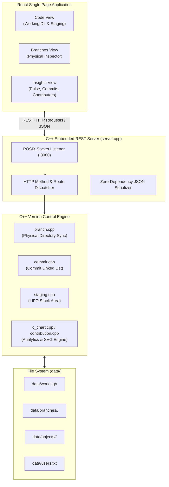
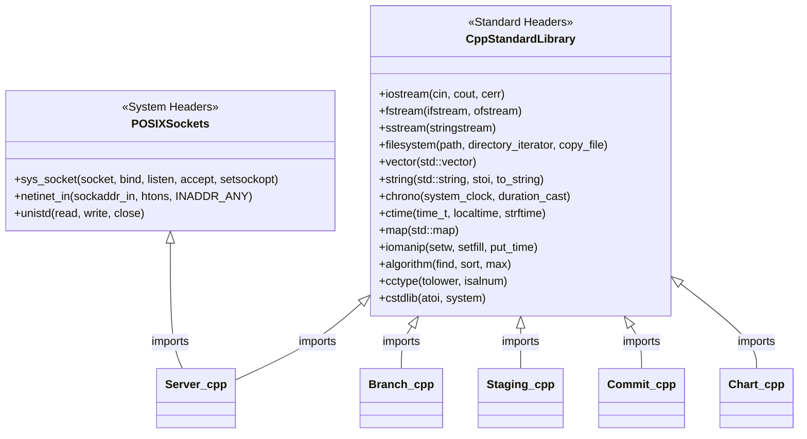
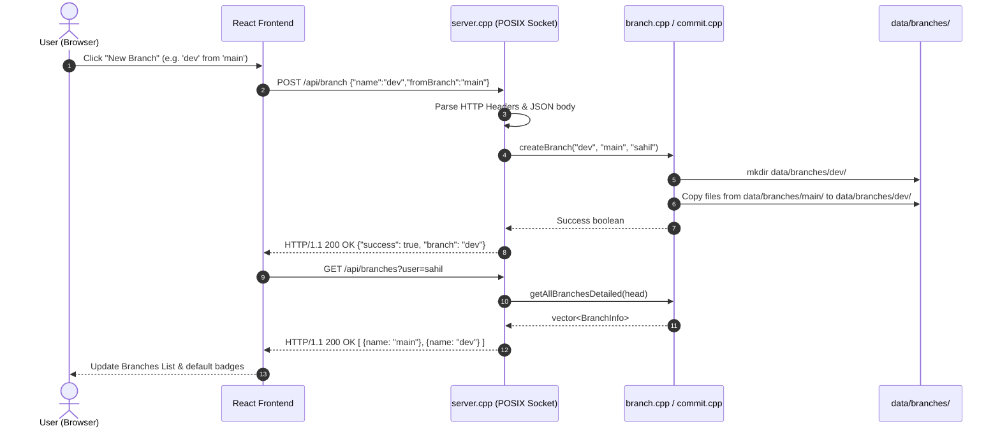
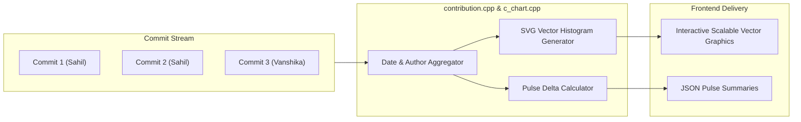

# MiniVCS Comprehensive Technical Documentation 📘
### In-Depth Guide to the C++ Core, Predefined Standard Headers, Physical Branching Engine, and Frontend Bridge

---

## 📑 Table of Contents
1. [System Architecture Overview](#1-system-architecture-overview)
2. [Physical Branch Storage & Lifecycle Engine](#2-physical-branch-storage--lifecycle-engine)
3. [Exhaustive Predefined C++ Standard Headers Reference](#3-exhaustive-predefined-c-standard-headers-reference)
4. [C++ to Frontend Communication Bridge (HTTP REST Engine)](#4-c-to-frontend-communication-bridge-http-rest-engine)
5. [C++ Native Chart & Contribution Analytics Engine](#5-c-native-chart--contribution-analytics-engine)
6. [Data Structures and Algorithmic Complexity](#6-data-structures-and-algorithmic-complexity)
7. [Viva & Project Defense Guide](#7-viva--project-defense-guide)

---

## 1. System Architecture Overview

MiniVCS consists of three primary layers:
1. **Core Data Engine (C++17)**: Handles storage, stack-based staging, linked-list commit history, SHA snapshotting, and physical directory synchronization.
2. **Embedded POSIX HTTP Server (`server.cpp`)**: A zero-dependency multi-client socket listener translating REST calls from the web interface into direct C++ function calls.
3. **Reactive Presentation Layer (React + Vite)**: A single-page application providing GitHub-style views for Code, Branch Management, and Insights.



---

## 2. Physical Branch Storage & Lifecycle Engine

Unlike Git which traditionally uses lightweight references (pointers storing 40-character SHA hashes) with a packfile object store, **MiniVCS implements a transparent Physical Directory Branching System**.

### 2.1 Disk Layout
* Every branch exists as a real folder under `data/branches/<branchName>/`.
* Every commit snapshot exists under `data/objects/<commitId>/`.
* Every active user workspace exists under `data/working/<username>/`.

```text
data/
├── branches/
│   ├── main/
│   │   ├── code.c
│   │   └── notes.txt
│   └── feature/
│       └── notes.txt
├── objects/
│   ├── 1729230000/
│   └── 1729230500/
└── working/
    └── sahil/
        ├── code.c
        └── notes.txt
```

### 2.2 Branch Lifecycle Operations

#### A. Branch Initialization (`initBranchSystem`)
* Scans `data/branches/`. If no `main` folder exists, it is created.
* If `main` is empty, it populates it by inspecting the latest commit on the `main` branch or pulling from existing working directories.
* Historical commits on different branches are auto-scanned to restore any missing branch folders.

#### B. Branch Creation (`createBranch`)
```text
Algorithm: createBranch(newBranch, fromBranch, creator)
1. Verify newBranch is not empty and contains no illegal path characters ('/', '..', '\\').
2. Check if data/branches/<newBranch> already exists. If yes, return error.
3. Create filesystem directory data/branches/<newBranch>/.
4. If data/branches/<fromBranch>/ exists and has files:
      Copy every file from data/branches/<fromBranch>/ to data/branches/<newBranch>/.
   Else if data/working/<creator>/ has files:
      Copy files from user's current working directory.
5. Return success.
```

#### C. Branch Switching / Checkout (`switchBranch`)
```text
Algorithm: switchBranch(username, targetBranch)
1. Verify targetBranch exists under data/branches/<targetBranch>/.
2. Remove all existing files inside data/working/<username>/.
3. Re-create data/working/<username>/ directory.
4. Copy all files from data/branches/<targetBranch>/ into data/working/<username>/.
5. Record active branch for username in data/users.txt.
6. Return success.
```

#### D. Commit Synchronization (`syncBranchWithCommit`)
Whenever a user stages files and runs `git commit -m "..." -b <branch>`:
1. `commitAllWithMessage()` writes a permanent snapshot to `data/objects/<commitId>/`.
2. It immediately invokes `syncBranchWithCommit(branch, commitId)`.
3. The branch folder `data/branches/<branch>/` is cleared and repopulated with the snapshot files from `data/objects/<commitId>/`.
4. This ensures that the physical branch folder always mirrors the exact state of the latest commit on that branch.

#### E. Safe Branch Deletion (`removeBranch`)
* Safeguard check: If `branchName == "main"`, deletion is strictly refused with an error response.
* For feature branches, `std::filesystem::remove_all("data/branches/" + branchName)` removes the directory from disk.

---

## 3. Exhaustive Predefined C++ Standard Headers Reference

This section lists **every predefined standard library and POSIX header file** utilized across the MiniVCS codebase, the exact source files where each is included, and the specific symbols, functions, and classes imported from them.



---

### Detailed Header-by-Header Breakdown:

### 1. `<iostream>`
* **Used in**: `main.cpp`, `commit.cpp`, `staging.cpp`, `revert.cpp`, `branch.cpp`, `login.cpp`, `server.cpp`, `contribution.cpp`, `c_chart.cpp`.
* **Symbols & Methods Used**:
  * `std::cout`: Standard console output stream used to print CLI menus, server startup logs, commit logs, and ASCII charts.
  * `std::cin`: Standard console input stream used to accept terminal user selections, commit messages, and usernames.
  * `std::cerr`: Standard error stream used for reporting socket binding failures, file read errors, and stack underflows.
  * `std::endl`: Stream manipulator that inserts a newline character and flushes the output buffer.

### 2. `<fstream>`
* **Used in**: `commit.cpp`, `staging.cpp`, `branch.cpp`, `login.cpp`, `revert.cpp`, `server.cpp`, `contribution.cpp`.
* **Symbols & Methods Used**:
  * `std::ifstream`: File input stream used to read file contents from disk (`users.txt`, `commits.txt`, user working files).
    * `.is_open()`: Verifies file opened successfully.
    * `.good()`: Checks if file state is valid for reading.
    * `.close()`: Explicitly releases file descriptors.
  * `std::ofstream`: File output stream used to write snapshots, update working files, and record users.
    * `std::ios::app`: Mode flag passed to append entries to `commits.txt` and `users.txt`.
    * `std::ios::trunc`: Mode flag passed to overwrite file contents.
  * `std::getline(stream, str)`: Reads line-by-line input from files until delimiter.

### 3. `<sstream>`
* **Used in**: `server.cpp`, `commit.cpp`, `staging.cpp`, `branch.cpp`, `c_chart.cpp`, `contribution.cpp`.
* **Symbols & Methods Used**:
  * `std::stringstream`: In-memory string stream buffer.
    * `<<` operator: Concatenates integers, strings, timestamps, and SVG XML attributes into a contiguous string.
    * `.str()`: Converts the accumulated buffer into a `std::string`.
    * `>>` operator: Parses whitespace-delimited tokens from HTTP request lines and commit logs.

### 4. `<filesystem>` (C++17)
* **Used in**: `branch.cpp`, `commit.cpp`, `staging.cpp`, `server.cpp`, `revert.cpp`.
* **Symbols & Methods Used**:
  * `std::filesystem::path`: Cross-platform path abstraction.
  * `std::filesystem::exists(path)`: Checks if a file or directory exists on disk.
  * `std::filesystem::create_directories(path)`: Recursively creates directory hierarchies (e.g., `data/branches/<name>/`).
  * `std::filesystem::directory_iterator(path)`: Iterates through files inside a directory without external dependencies.
  * `std::filesystem::directory_entry`: Represents an individual file or directory inside an iterator.
    * `.is_regular_file()`: Identifies regular files (excluding `.DS_Store` or nested folders).
    * `.path().filename().string()`: Extracts the simple filename string.
  * `std::filesystem::copy_file(src, dst, options)`: Copies file content at the OS filesystem level.
    * `std::filesystem::copy_options::overwrite_existing`: Overwrites destination if it exists.
  * `std::filesystem::remove(path)`: Deletes an individual file.
  * `std::filesystem::remove_all(path)`: Recursively deletes a directory and all child files (used in branch deletion and checkout).
  * `std::filesystem::file_size(path)`: Returns size in bytes.

### 5. `<vector>`
* **Used in**: `branch.h`, `branch.cpp`, `commit.h`, `commit.cpp`, `staging.h`, `staging.cpp`, `server.cpp`, `contribution.h`, `contribution.cpp`, `c_chart.h`, `c_chart.cpp`.
* **Symbols & Methods Used**:
  * `std::vector<T>`: Dynamic sequence container.
    * `.push_back(val)`: Appends elements (e.g., commit nodes, file entries, branch objects).
    * `.size()`: Returns current count of stored elements.
    * `.empty()`: Checks if container is empty.
    * `.clear()`: Empties the container.
    * Range-based `for (const auto& item : vec)`: Iteration over vector elements.

### 6. `<string>`
* **Used in**: Everywhere across all `.h` and `.cpp` files.
* **Symbols & Methods Used**:
  * `std::string`: STL string class.
  * `std::to_string(num)`: Converts integer/timestamp to string.
  * `std::stoi(str)`: Converts numeric string to signed integer.
  * `.find(substr)` / `.rfind(substr)`: Locates substring occurrences.
  * `.substr(start, length)`: Extracts sub-sections of strings (used in HTTP query string parsing).
  * `.length()` / `.size()`: String length.
  * `std::string::npos`: Sentinel representing "not found".

### 7. `<chrono>`
* **Used in**: `commit.cpp`, `server.cpp`, `contribution.cpp`, `c_chart.cpp`.
* **Symbols & Methods Used**:
  * `std::chrono::system_clock::now()`: Queries the current system wall-clock time.
  * `std::chrono::duration_cast<std::chrono::seconds>(...)`: Casts high-resolution timestamps down to epoch seconds.
  * `.time_since_epoch().count()`: Returns integer UNIX timestamp for commit IDs.

### 8. `<ctime>`
* **Used in**: `commit.cpp`, `server.cpp`, `contribution.cpp`, `c_chart.cpp`.
* **Symbols & Methods Used**:
  * `std::time_t`: Integer type holding seconds since UNIX epoch.
  * `std::localtime(&time_t)`: Converts epoch time into a broken-down `struct tm` (year, month, day, hour, min, sec).
  * `std::strftime(buf, size, format, tm)`: Formats dates into human-readable strings (`%Y-%m-%d %H:%M:%S`).

### 9. `<map>`
* **Used in**: `contribution.cpp`, `contribution.h`, `c_chart.cpp`, `server.cpp`.
* **Symbols & Methods Used**:
  * `std::map<Key, Value>`: Red-Black tree associative array.
    * `map[key]++`: Increments commit counts mapped to a specific date string or author username.
    * `.find(key)`: Logarithmic-time key lookup.
    * Iteration via `for (const auto& [date, count] : dateMap)`.

### 10. `<iomanip>`
* **Used in**: `c_chart.cpp`, `contribution.cpp`, `server.cpp`.
* **Symbols & Methods Used**:
  * `std::setw(int)`: Sets stream output field width for formatted CLI table alignment.
  * `std::setfill(char)`: Defines padding character for date formatting (`01`, `02`).
  * `std::put_time(tm, format)`: Stream manipulator formatting date structs.

### 11. `<algorithm>`
* **Used in**: `contribution.cpp`, `c_chart.cpp`, `server.cpp`, `branch.cpp`.
* **Symbols & Methods Used**:
  * `std::max(a, b)`: Calculates peak commit counts for histogram normalization.
  * `std::sort(begin, end, comparator)`: Sorts commit history vectors in chronological order.
  * `std::find(begin, end, val)`: Searches containers for specific elements.

### 12. `<cctype>` & `<cstdlib>`
* **Used in**: `server.cpp`, `main.cpp`, `login.cpp`.
* **Symbols & Methods Used**:
  * `std::tolower(char)`: Case-insensitive comparisons.
  * `std::isalnum(char)`: Sanitizes branch names, usernames, and file inputs.
  * `std::atoi(str)`: Converts command-line port arguments (`argv[1]`) into integer port numbers.

### 13. System Sockets (`<sys/socket.h>`, `<netinet/in.h>`, `<unistd.h>`)
* **Used in**: `server.cpp`.
* **Symbols & Methods Used**:
  * `socket(AF_INET, SOCK_STREAM, 0)`: Creates TCP stream socket descriptor.
  * `setsockopt(sock, SOL_SOCKET, SO_REUSEADDR, ...)`: Enables fast port reuse preventing `Address already in use` errors upon restart.
  * `sockaddr_in`: IPv4 socket address structure specifying address family, `htons(port)`, and `INADDR_ANY`.
  * `bind(sock, (struct sockaddr*)&addr, sizeof(addr))`: Binds socket to local network interface.
  * `listen(sock, backlog)`: Marks socket as passive server listening for incoming connections.
  * `accept(sock, ...)`: Extracts first connection request on the queue, creating a new connected client socket.
  * `recv(clientSock, buf, size, flags)`: Reads raw HTTP request strings from the client socket.
  * `send(clientSock, buf, len, flags)`: Transmits HTTP status headers and JSON payloads back to the client.
  * `close(sock)`: Closes client connection and releases OS socket file descriptor.

---

## 4. C++ to Frontend Communication Bridge (HTTP REST Engine)

MiniVCS does **not** rely on heavy external frameworks (such as Express, Crow, or Boost.Beast). Instead, it implements a lean, self-contained POSIX socket HTTP server in [`server.cpp`](file:///Users/sahil/Projects/minivcs2/server.cpp).



### 4.1 CORS (Cross-Origin Resource Sharing)
To allow the Vite frontend running on `http://localhost:5173` to communicate seamlessly with the C++ server on `http://localhost:8080`, every HTTP response emitted by `server.cpp` includes standard CORS headers:
```http
HTTP/1.1 200 OK
Content-Type: application/json
Access-Control-Allow-Origin: *
Access-Control-Allow-Methods: GET, POST, DELETE, OPTIONS
Access-Control-Allow-Headers: Content-Type
```
Preflight `OPTIONS` requests are caught immediately and responded to with `204 No Content`.

---

## 5. C++ Native Chart & Contribution Analytics Engine

The Insights view renders three key GitHub-style sections: **Pulse**, **Commits Histogram**, and **Contributors**.



1. **Pulse Analytics (`contribution.cpp`)**:
   * Evaluates the active time window.
   * Quantifies **Active Contributors** ($Count_{distinct}(authors)$).
   * Aggregates total commit volume and net file modifications.
2. **Native SVG Histogram Generator (`c_chart.cpp`)**:
   * Constructs pure SVG XML code in memory using `<svg>`, `<rect>`, `<line>`, and `<text>` elements.
   * Dynamically calculates bar height using linear normalization:
     $$\text{BarHeight} = \left( \frac{\text{CommitsOnDay}}{\text{MaxCommits}} \right) \times (\text{PlotHeight} - 40)$$
   * Emits responsive SVG strings directly serialized into the JSON payload of `GET /api/contributions`.

---

## 6. Data Structures and Algorithmic Complexity

| Feature | Data Structure | Time Complexity | Implementation & Rationale |
| :--- | :--- | :--- | :--- |
| **Branch Hierarchy** | Manual N-ary Tree (`BranchTree`, `TreeNode`) | Search: $O(B)$<br>Insert: $O(1)$ | Manual tree in `branch.h` tracking branch lineage, child branches, files, and latest commit IDs. |
| **Commit History** | Singly Linked List (`CommitNode*`) | Insertion: $O(1)$<br>Traversal: $O(N)$ | Commits form a unidirectional chain with pointer to parent node (`next`). |
| **Staging Area** | LIFO Stack (`Stack<T>`) | Push: $O(1)$<br>Pop: $O(1)$ | Manual stack in `stack.h` staging and unstaging files in reverse chronological order. |
| **Physical Storage** | Directory Snapshots (`data/branches/`) | Creation: $O(F)$<br>Checkout: $O(F)$ | Complete file isolation per branch; synchronized bi-directionally with working directories via `syncWorkingWithBranch()`. |
| **Contribution Map** | Red-Black Tree (`std::map<string, int>`) | Lookup: $O(\log D)$<br>Insert: $O(\log D)$ | Automatic lexicographical sorting by date strings (`YYYY-MM-DD`). |

---

## 7. Viva & Project Defense Guide

When demonstrating or defending this project in an exam, presentation, or interview:

1. **How does MiniVCS handle branches differently from Git?**
   * *Answer*: Git uses 41-byte text files in `.git/refs/heads/` pointing to a SHA-1 commit object in a compressed packfile. MiniVCS uses **Physical Directory Snapshot Isolation** (`data/branches/<branchName>/`). Each branch has an actual directory on disk, ensuring maximum transparency, zero corruption risk, and instant inspection via the terminal or file manager.

2. **Why can't external libraries be used for JSON and HTTP?**
   * *Answer*: Building the HTTP socket listener and JSON encoder using standard C++17 library headers (`<sys/socket.h>`, `<sstream>`, `<filesystem>`) demonstrates mastery of network sockets, POSIX system calls, OS file descriptor management, and low-level memory handling.

3. **How does branch switching guarantee working directory safety?**
   * *Answer*: When switching to branch $B$, the engine clears `data/working/<user>/` and clones the contents of `data/branches/<B>/`. The user's active branch state is saved in `data/users.txt`, preventing cross-user contamination.

